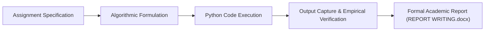

# 📑 Python Academic Lab Report — Computational Problem-Solving Documentation

<p align="center">
  
</p>

<p align="center">
  <b>Formal Academic Engineering Documentation: Problem Statement Decomposition, Variable State Tracing, and Empirical Output Validation.</b>
</p>

<p align="center">
  
  
  
  
</p>

<p align="center">
  
</p>

---

<a id="table-of-contents"></a>
## 📌 Table of Contents

- [📖 Executive Summary & Overview](#executive-summary--overview)
- [🎯 Key Features & Capabilities](#features)
- [🏗️ System Architecture & Pipeline](#system-architecture--pipeline)
- [🛠️ Tech Stack Breakdown](#tech-stack-breakdown)
- [⚙️ Reproducible Quickstart & Setup](#setup)
- [📁 Project Directory Layout](#project-layout)
- [🔮 Future Improvements & Roadmap](#future-improvements--roadmap)
- [🤝 Contributing Guidelines](#contributing-guidelines)
- [👨‍💻 Author & Contributions](#author--contributions)

---

<a id="executive-summary--overview"></a>
## 📖 Executive Summary & Overview

Clear technical documentation is as critical as the software itself. Rigorous technical reporting ensures software engineers can communicate algorithmic complexity, structural design decisions, test coverage metrics, and edge-case behaviors to peers, instructors, and stakeholders.

The **Python Academic Laboratory Report** (`Python-assignment-Report`) archives the formal technical document `REPORT WRITING.docx`, authored by **Amaraiah C** at Alliance University. The report details programmatic solutions to computational assignments, documenting test case boundaries, input sanitization protocols, and execution traces.

---

<a id="key-features--capabilities"></a>
## 🎯 Key Features & Capabilities

### 📝 1. Structured Academic Documentation
- Formal report following institutional academic formatting and submission standards.

### 🔍 2. Variable State Tracing
- Step-by-step state verification of variable mutations across algorithmic runs.

---

<a id="system-architecture--pipeline"></a>
## 🏗️ System Architecture & Pipeline



---

<a id="tech-stack-breakdown"></a>
## 🛠️ Tech Stack Breakdown

| Category | Specification | Application |
| :--- | :--- | :--- |
| **Documentation Suite** | Microsoft Word (`.docx`) | Academic report compilation and typography |
| **Underlying Language** | Python 3.x | Programming solutions verified within the report |
| **Academic Standards** | Alliance University Curriculum | Formal laboratory evaluation protocols |

---

<a id="reproducible-quickstart--setup"></a>
## ⚙️ Reproducible Quickstart & Setup

```bash
# 1. Clone repository
git clone https://github.com/Amaraiah11/Python-assignment-Report.git
cd Python-assignment-Report

# 2. View formal technical report
# Open 'REPORT WRITING.docx' in Microsoft Word or LibreOffice
```

---

<a id="project-directory-layout"></a>
## 📁 Project Directory Layout

```text
Python-assignment-Report/
├── REPORT WRITING.docx        # Graded technical laboratory report document
└── README.md                  # Comprehensive documentation and summary
```

---

<a id="future-improvements--roadmap"></a>
## 🔮 Future Improvements & Roadmap

- [ ] Convert Word documentation into a reproducible Jupyter Book or Markdown website.

---

<a id="author--contributions"></a>
## 👨‍💻 Author & Contributions

This project is developed and maintained with rigorous engineering standards by **Amaraiah C**, Software Developer and Applied Data Analytics Practitioner studying Bachelor of Computer Applications (BCA) at Alliance University, Bangalore.

- 🌐 **GitHub Profile:** [@Amaraiah11](https://github.com/Amaraiah11)
- 💼 **LinkedIn Profile:** [Connect on LinkedIn](https://www.linkedin.com/in/amaraiah-c/)
- 📧 **Institutional Email:** `camaraiahBCA24@ced.alliance.edu.in`

### 🤝 Contributing Guidelines
Contributions, bug reports, and architectural discussions are welcome!
1. **Fork** the repository: `https://github.com/Amaraiah11/Python-assignment-Report`
2. **Create a Feature Branch:**
   ```bash
   git checkout -b feature/your-feature-name
   ```
3. **Commit Your Enhancements:**
   ```bash
   git commit -m "feat: enhance feature logic"
   ```
4. **Push to Your Branch:**
   ```bash
   git push origin feature/your-feature-name
   ```
5. **Open a Pull Request** against the `main` branch.

---

<p align="center">
  <b>⭐ If this codebase or documentation assisted your engineering workflows, please star the repository! ⭐</b>
</p>

<p align="center">
  
</p>
