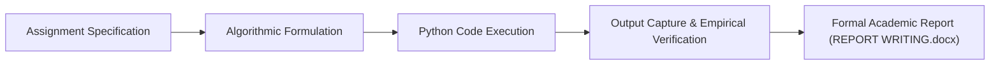

<p align="center">
  
</p>

<p align="center">
  
  
  
  
</p>

<a id="overview"></a>
## 📖 Executive Summary & Overview

Clear technical documentation is as critical as the software itself. Rigorous technical reporting ensures software engineers can communicate algorithmic complexity, structural design decisions, test coverage metrics, and edge-case behaviors to peers, instructors, and stakeholders.

The **Python Academic Laboratory Report** (`Python-assignment-Report`) archives the formal technical document `REPORT WRITING.docx`, authored by **Amaraiah C** (Registration: PROV/BCA/...) at Alliance University. The report details programmatic solutions to computational assignments, documenting test case boundaries, input sanitization protocols, and execution traces.

<a id="toc"></a>
## 📑 Table of Contents

- [📖 Executive Summary & Overview](#overview)
- [🎯 Key Features & Capabilities](#features)
- [🏗️ System Architecture & Pipeline](#architecture)
- [🛠️ Tech Stack Breakdown](#tech-stack)
- [⚙️ Reproducible Quickstart & Setup](#setup)
- [📁 Project Directory Layout](#project-layout)
- [👨‍💻 Author & Contributions](#author)

<a id="features"></a>
## 🎯 Key Features & Capabilities

- **Formal Academic Documentation:** Structured technical report following university formatting guidelines.
- **Problem Statement Analysis:** Methodical breakdown of computational challenges and constraint boundaries.
- **Algorithmic Tracing:** Step-by-step state verification of variable mutation across execution runs.
- **Output Validation:** Empirical proof of code correctness against both nominal and boundary test data.

<a id="architecture"></a>
## 🏗️ System Architecture & Pipeline



<a id="tech-stack"></a>
## 🛠️ Tech Stack Breakdown

| Category | Specification | Application |
| :--- | :--- | :--- |
| **Documentation Suite** | Microsoft Word (`.docx`) | Academic report compilation and typography |
| **Underlying Language** | Python 3.x | Programming solutions verified within the report |
| **Academic Standards** | Alliance University Curriculum | Formal laboratory evaluation protocols |

<a id="setup"></a>
## ⚙️ Reproducible Quickstart & Setup

```bash
# 1. Clone repository
git clone https://github.com/Amaraiah11/Python-assignment-Report.git
cd Python-assignment-Report

# 2. View formal technical report
# Open 'REPORT WRITING.docx' in Microsoft Word, LibreOffice, or Google Docs
```

<a id="project-layout"></a>
## 📁 Project Directory Layout

```text
Python-assignment-Report/
├── REPORT WRITING.docx        # Graded technical laboratory report document
└── README.md                  # Comprehensive documentation and summary
```

<a id="author"></a>
## 👨‍💻 Author & Contributions

This project is developed and maintained with high technical rigour by **Amaraiah C**, Software Engineer and Data Analytics Practitioner studying Bachelor of Computer Applications (BCA) at Alliance University.

- 🌐 **GitHub:** [@Amaraiah11](https://github.com/Amaraiah11)
- 💼 **LinkedIn:** [Connect on LinkedIn](https://www.linkedin.com/in/amaraiah-c/)
- 📧 **Institutional Contact:** `camaraiahBCA24@ced.alliance.edu.in`

### 🤝 Contribution Guidelines
Contributions, bug reports, and architectural discussions are welcome!
1. **Fork** the repository: `https://github.com/Amaraiah11/Python-assignment-Report`
2. **Branch**: `git checkout -b feature/your-feature-name`
3. **Commit**: `git commit -m "feat: enhance feature logic"`
4. **Push**: `git push origin feature/your-feature-name`
5. **Open Pull Request** against the `main` branch.

---

<p align="center">
  <b>⭐ If this codebase or documentation assisted your engineering workflows, please star the repository! ⭐</b>
</p>

<p align="center">
  
</p>
